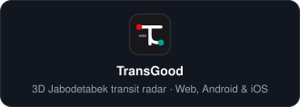
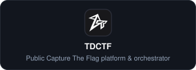

<h2 align="center">Alfarisi Azmir</h2>

  <code>farishhz</code> &nbsp;—&nbsp; Software Engineer · Backend, Mobile &amp; Cybersecurity

  
  
  
  
  

 

  <a href="https://transgood.app"><picture><source media="(prefers-color-scheme: light)" srcset="assets/cards/transgood-light.svg"></picture></a><a href="https://tdctf.my.id"><picture><source media="(prefers-color-scheme: light)" srcset="assets/cards/tdctf-light.svg"></picture></a>  

 

  <picture>
    <source media="(prefers-color-scheme: dark)" srcset="assets/stack-dark.svg">
    <source media="(prefers-color-scheme: light)" srcset="assets/stack-light.svg">
    
  </picture>

  <picture>
    <source media="(prefers-color-scheme: dark)" srcset="https://github-readme-streak-stats-eight.vercel.app/?user=farishhz&amp;hide_border=true&amp;background=00000000&amp;stroke=30363D&amp;ring=00A19A&amp;fire=00A19A&amp;currStreakNum=E6EDF3&amp;sideNums=E6EDF3&amp;currStreakLabel=8B949E&amp;sideLabels=8B949E&amp;dates=8B949E">
    <source media="(prefers-color-scheme: light)" srcset="https://github-readme-streak-stats-eight.vercel.app/?user=farishhz&amp;hide_border=true&amp;background=00000000&amp;stroke=D0D7DE&amp;ring=00A19A&amp;fire=00A19A&amp;currStreakNum=1F2328&amp;sideNums=1F2328&amp;currStreakLabel=656D76&amp;sideLabels=656D76&amp;dates=656D76">
    
  </picture>

